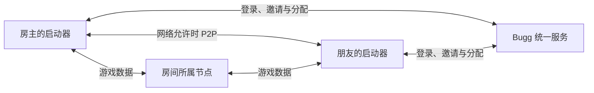

<div align="center">

<<<<<<< HEAD
# Bugg 联机节点

**朋友在哪个网络，都想和你进入同一个世界。**

在启动器里建房、邀请、加入。能直连时尝试直连，需要中继时由节点接力。

[](https://github.com/vdjango/minecraft-tunnel-native/actions/workflows/core.yml)
[](https://github.com/vdjango/minecraft-tunnel-native/releases/latest)
[](https://github.com/vdjango/minecraft-tunnel-native/releases)
[](CMakeLists.txt)
[](docs/06-原生桥与SDK.md)
[](LICENSE)

[**下载启动器**](https://download.bugg.icu/) · [**玩家教程**](https://bugg.icu/docs) · [**统一账号**](https://node.bugg.icu/login) · [**贡献节点**](docs/03-节点部署与配置.md) · [**报告问题**](https://github.com/vdjango/minecraft-tunnel-native/issues)
=======
# Buggcraft 联机节点

### 让不同网络里的朋友，加入同一个 Minecraft 世界

房主开世界，好友进房间。多个节点互联，房间和好友信息互通。

[](https://github.com/vdjango/minecraft-tunnel-native/actions/workflows/core.yml)
[](https://github.com/vdjango/minecraft-tunnel-native/releases/latest)
[](https://github.com/vdjango/minecraft-tunnel-native/releases)
[](https://github.com/vdjango/minecraft-tunnel-native/stargazers)
[](https://download.bugg.icu)
[](CMakeLists.txt)
[](LICENSE)

[官网](https://bugg.icu) · [下载启动器](https://download.bugg.icu) · [联机入口](https://node.bugg.icu) · [玩家教程](https://bugg.icu/docs) · [反馈问题](https://github.com/vdjango/minecraft-tunnel-native/issues)
>>>>>>> origin/main

</div>

---

<<<<<<< HEAD
房主开一个世界，朋友来一起玩。**存档仍在房主电脑上**，Bugg 联机节点帮助连接两端网络，在无法点对点直连时转发游戏数据。它与 Bugg 启动器配合，也提供原生桥和 SDK，供其他桌面客户端接入。

普通玩家无需安装服务器软件，也不需要自己搭建节点。直接 [下载启动器](https://download.bugg.icu/)，从「联机」开始。

## 从邀请到一起玩

| 你关心的事 | 联机时如何处理 |
| --- | --- |
| 不想让朋友研究地址和端口 | 在启动器创建房间，通过邀请加入；账号与设备授权走统一服务。 |
| 朋友在不同网络里 | 桥尝试 P2P；无法直连时使用节点中继。实际路径取决于双方网络。 |
| 想知道连接经过哪里 | 桥提供当前节点、连接路径、到节点与到房主的延迟信息，供启动器展示。 |
| 游戏内容不一致 | 可交换游戏环境与资源清单，配合客户端进行房间内容同步。 |
| 希望世界由自己保管 | 房主运行 Minecraft、保管存档；节点提供连接，不代替游戏服务器。 |

### 房主

1. 在启动器登录联机账号，选择实例并创建房间。
2. 启动游戏，将单人世界「对局域网开放」，按启动器提示关联世界。
3. 把邀请发给朋友，保持游戏与联机连接运行。

### 加入朋友

1. 登录联机账号，打开邀请或使用房间邀请信息。
2. 检查游戏版本、加载器和模组环境，按提示准备缺少的内容。
3. 连接房间，再按启动器提示进入游戏。

遇到问题可从 [创建房间](https://bugg.icu/docs/help/create-room)、[加入房间](https://bugg.icu/docs/help/join-room) 和 [故障排查](https://bugg.icu/docs/help/troubleshooting) 开始。


## 连接如何工作



**统一服务处理账号和连接分配，游戏字节通过直连或节点中继传输。** 加入已有房间时跟随房主的节点归属；选择更近的节点，并不意味着可以把同一个房间的玩家分到不同服务器。

本仓库维护联机节点、原生桥和 C ABI SDK。[统一服务](https://github.com/vdjango/buggcraft-control-native) 独立维护。节点不提供玩家登录页或管理网页，官方服务与自建服务通过配置选择。

## 性能优化，落在连接过程中

- **减少额外绕路**：网络允许时尝试 P2P，降低对中继出口的依赖。
- **游戏流优先**：文件同步分批调度，转发队列有界并带背压，避免无限堆积数据。
- **减少重复文件处理**：文件摘要复用单遍读取，传输完成后核对长度与摘要再提交。
- **按 CPU 能力选择实现**：可选 SIMD 内核与库的硬件加速保留通用回退，不要求每位玩家都有 AVX2 或 AVX-512。
- **默认关闭额外中继压缩**：减少桥两端额外的编解码；SSH/WebRTC 加密与完整性校验仍保留。

这些措施改善的是连接与文件处理，**不等于游戏 FPS 提升，也不能消除线路本身的延迟**。压缩是否划算仍与带宽、载荷和 CPU 有关；实际结果、硬件与未测环境见 [性能报告](docs/30-性能报告/00-实测报告索引.md) 和 [压缩配置](docs/11-转发性能与压缩配置.md)。

## 自建或贡献一个节点

节点适合希望提供中继资源的个人与社区。选择接入的统一服务，配置公开入口、地区与容量后，节点会进行注册、可达性验证和心跳；重启继续使用自己的节点身份。

| 你需要准备 | 用途 |
| --- | --- |
| 服务器与可用公网入口 | 接受游戏连接和控制服务的可达性验证；按部署说明配置防火墙。 |
| 统一服务地址与接入信息 | 官方或自建服务均可，节点不持有统一服务管理员凭据。 |
| 地区、容量与带宽预算 | 用于分配与限额，避免把共享节点当作无限资源。 |

从 [发行页面](https://github.com/vdjango/minecraft-tunnel-native/releases) 查看实际提供的系统与架构，再按 [节点部署与配置](docs/03-节点部署与配置.md) 操作。**发行包与当前源码可能不同**，旧版网页初始化或联邦说明不适用于现在的受管节点。

当前源码的转发核心、桥和 SDK 使用 C++20，节点运行控制仍含 Python 适配层，原生迁移尚未全部完成。源码安装的依赖与命令集中在部署指南中，不能将旧包描述为已经完成的纯 C++ 安装包。

## 给接入者与贡献者

| 目标 | 文档 |
| --- | --- |
| 在自己的客户端接入联机 | [接入与会话流程](docs/05-联机接入与会话流程.md) · [原生桥与 SDK](docs/06-原生桥与SDK.md) |
| 查请求、事件与错误码 | [协议规范](PROTOCOL_STANDARD.md) |
| 构建、测试或发布 | [构建与发布](docs/02-构建与发布.md) · [开发指南](docs/01-工程结构与开发指南.md) |
| 了解权限与数据边界 | [安全边界](docs/04-节点安全边界.md) · [统一控制](docs/12-统一控制与稳定性.md) |
| 找到其他说明 | [文档总览](docs/00-文档总览.md) |

CLI 与 C ABI 复用同一个桥引擎，接入者无需再实现一套转发协议。提交改动前请阅读 [协作约束](AGENTS.md)，复用已有方法并维护方法/DOM 清单。

报告问题时，请提供启动器、节点与桥的版本、双方系统、游戏与加载器版本、复现步骤及已脱敏日志。启动器内的「问题反馈」发送到统一服务；也可在本仓库 [Issues](https://github.com/vdjango/minecraft-tunnel-native/issues) 报告节点或 SDK 问题。

## 许可

本项目采用 **AGPL-3.0-or-later**，详见 [LICENSE](LICENSE)；依赖与第三方声明见 [THIRD_PARTY_NOTICES.md](THIRD_PARTY_NOTICES.md)。

Bugg 与 Mojang、Microsoft 无隶属关系。Minecraft 是 Mojang Studios 的商标。
=======
## 我能用它做什么？

和朋友玩 Minecraft Java 版：创建房间、邀请好友、查找公开房间，并同步联机需要的游戏配置。

世界和存档保存在房主电脑上。房主需要运行游戏并开放世界；节点负责发现房间、协商连接，以及在无法直连时转发游戏数据。无需给每个世界另租一台 Minecraft 服务器。

- **好友联机**：通过房间列表或邀请进入好友的世界。
- **优先直连**：网络允许时使用 P2P；无法直连时由节点中转。
- **跨节点找房间**：加入同一联邦的节点可以互通房间和好友信息。
- **网页管理**：设置节点名称、地区、注册权限、人数预算和网络连接。
- **文件加速接入**：可接入 Buggcraft 源站，帮助补齐联机需要的资源文件。

## 我只是想和朋友玩

1. 到[下载站](https://download.bugg.icu)下载 Buggcraft 启动器，解压后运行。
2. 打开联机大厅，连接可信的节点，按浏览器提示登录并确认设备。
3. 房主选择游戏实例、创建房间，进入世界并开放到局域网。
4. 好友从房间列表或邀请进入，按启动器提示补齐游戏版本和模组，再连接游戏。

如果节点支持注册，可以按页面指引创建账号；未开放注册时联系节点管理员。**普通玩家不需要安装本仓库的节点程序，也不需要接触联邦管理凭据。**

操作截图、整合包导入和常见问题见[玩家教程](https://bugg.icu/docs)。找队友或交流问题，可添加微信 **junsi223** 联系入群，或加入 QQ 群 **849362477**。

## 联邦网络是什么？

可以把它理解为：**多位管理员各自运行节点，再把这些节点连接成一张共同的联机网络。**

例如，上海节点和武汉节点加入了同一联邦。房主连接上海创建房间，好友连接武汉，也能找到这个房间并加入，不用为了找房间反复切换节点。

| 联邦能做什么 | 对玩家有什么用 |
| --- | --- |
| 同步房间目录 | 在一个入口看到其他在线节点的公开房间 |
| 同步账号和好友相关信息 | 在同一联邦内使用账号、查找好友和接收联机邀请 |
| 提供房间所属节点的信息 | 启动器找到实际承接房间的节点，再建立连接 |
| 节点各自独立运行 | 一台节点停机时，其他节点仍能提供各自的服务 |

联邦不会把多台服务器的带宽合并，也不会代替房主运行世界。实际游戏流量优先尝试玩家之间直连；需要中转时，使用承接该房间的节点。房主关掉游戏，世界就会停止；承载连接的节点故障时，相关玩家可能需要重新连接。

**节点可以单独运行，加入联邦是可选项。** 联邦成员共享信任范围，管理员应只接入自己认可的网络。

## 我想提供一个节点

推荐 Ubuntu 24.04 amd64。从[最新发行版](https://github.com/vdjango/minecraft-tunnel-native/releases/latest)下载 `buggcraft-node_…_amd64.deb`，在服务器执行：

```bash
sudo apt install ./buggcraft-node_*_amd64.deb
sudo buggcraft-node setup
```

按照终端给出的地址打开网页，填写节点名称、公网地址和管理员信息，完成配置即可。安装包会配置后台服务、开机启动和自动校时；网络校时在后台进行。

联机默认需要开放 **TCP / UDP 3333**。网页可以通过 **HTTPS 443** 访问，节点内部的 **18443** 可由反向代理转接，不必直接暴露公网；NAT 服务器使用实际映射端口。具体 HTTPS 配置见[节点部署指南](docs/节点部署指南.md)。

### 如何加入已有联邦？

1. 向已有联邦的管理员申请入网邀请。
2. 登录自己节点的管理后台，打开“连接网络”，导入邀请。
3. 等待节点心跳和房间目录同步，在“节点网络”查看在线成员。

邀请包含管理凭据，只在管理员之间传递。普通玩家仍使用节点地址和浏览器登录，不用填写联邦邀请。

### 日常管理

```bash
sudo buggcraft-node status       # 查看服务状态
sudo buggcraft-node logs         # 查看最近日志
sudo systemctl restart buggcraft-node
```

升级前备份 `/var/lib/buggcraft-node`，再安装新版 `.deb`。升级会重启本节点，安排在无人联机时操作。安装、升级、证书、端口、自动校时和备份说明见[节点部署指南](docs/节点部署指南.md)。

### 怎么填写带宽和人数？

后台直接填写服务器的**上传带宽 Mbps**，例如 6、20、200；不用自己换算 MB/s。节点按每人流量预算和预留带宽估算可接纳访客数，房间人数还受单独上限限制。

页面的“预计中转余量”是预算值，不是性能承诺。CPU、内存、玩家视距、模组和区块加载都会影响实际体验，应结合后台实时流量调整。

## 开发、接入与贡献

想修改节点或把网络核心接入自己的启动器，请从[节点开发指南](docs/节点开发指南.md)开始；[构建指南](docs/构建指南.md)介绍环境和打包，[协议索引](docs/protocol/协议索引.md)与[原生桥接口](docs/原生桥动态库.md)介绍程序接入。完整资料见[文档索引](docs/文档索引.md)。

欢迎提交问题与改进。反馈时请附系统、版本、操作步骤和相关日志，并移除密码、私钥和个人凭据。

本项目使用 [AGPL-3.0-or-later](LICENSE)，第三方组件许可见 [THIRD_PARTY_NOTICES.md](THIRD_PARTY_NOTICES.md)。Buggcraft 与 Mojang / Microsoft 无隶属关系。
>>>>>>> origin/main
