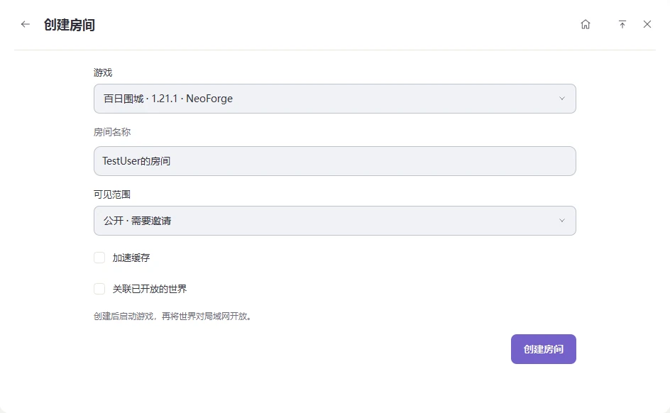
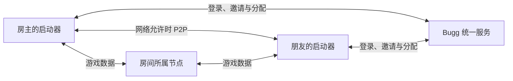

# Bugg 联机节点

**朋友在哪个网络，都想和你进入同一个世界。**

在启动器里建房、邀请、加入。能直连时尝试直连，需要中继时由节点接力。

[**下载启动器**](https://download.bugg.icu/) · [**玩家教程**](https://bugg.icu/docs) · [**统一账号**](https://node.bugg.icu/login) · [**贡献节点**](docs/03-节点部署与配置.md) · [**报告问题**](https://github.com/vdjango/minecraft-tunnel-native/issues)

---

房主开一个世界，朋友来一起玩。**存档仍在房主电脑上**，Bugg 联机节点帮助连接两端网络，在无法点对点直连时转发游戏数据。它与 Bugg 启动器配合，也提供原生桥和 SDK，供其他桌面客户端接入。

普通玩家无需安装服务器软件，也不需要自己搭建节点。直接 [下载启动器](https://download.bugg.icu/)，从「联机」开始。

## 从邀请到一起玩

| 你关心的事 | 联机时如何处理 |
| --- | --- |
| 不想让朋友研究地址和端口 | 在启动器创建房间，通过邀请加入；账号与设备授权走统一服务。 |
| 朋友在不同网络里 | 桥尝试 P2P；无法直连时使用节点中继。实际路径取决于双方网络。 |
| 想知道连接经过哪里 | 桥提供当前节点、连接路径、到节点与到房主的延迟信息，供启动器展示。 |
| 游戏内容不一致 | 可交换游戏环境与资源清单，配合客户端进行房间内容同步。 |
| 希望世界由自己保管 | 房主运行 Minecraft、保管存档；节点提供连接，不代替游戏服务器。 |

### 房主

1. 在启动器登录联机账号，选择实例并创建房间。
2. 启动游戏，将单人世界「对局域网开放」，按启动器提示关联世界。
3. 把邀请发给朋友，保持游戏与联机连接运行。

### 加入朋友

1. 登录联机账号，打开邀请或使用房间邀请信息。
2. 检查游戏版本、加载器和模组环境，按提示准备缺少的内容。
3. 连接房间，再按启动器提示进入游戏。

遇到问题可从 [创建房间](https://bugg.icu/docs/help/create-room)、[加入房间](https://bugg.icu/docs/help/join-room) 和 [故障排查](https://bugg.icu/docs/help/troubleshooting) 开始。

## 连接如何工作

**统一服务处理账号和连接分配，游戏字节通过直连或节点中继传输。** 加入已有房间时跟随房主的节点归属；选择更近的节点，并不意味着可以把同一个房间的玩家分到不同服务器。

本仓库维护联机节点、原生桥和 C ABI SDK。[统一服务](https://github.com/vdjango/buggcraft-control-native) 独立维护。节点不提供玩家登录页或管理网页，官方服务与自建服务通过配置选择。

## 性能优化，落在连接过程中

- **减少额外绕路**：网络允许时尝试 P2P，降低对中继出口的依赖。
- **游戏流优先**：文件同步分批调度，转发队列有界并带背压，避免无限堆积数据。
- **减少重复文件处理**：文件摘要复用单遍读取，传输完成后核对长度与摘要再提交。
- **按 CPU 能力选择实现**：可选 SIMD 内核与库的硬件加速保留通用回退，不要求每位玩家都有 AVX2 或 AVX-512。
- **默认关闭额外中继压缩**：减少桥两端额外的编解码；SSH/WebRTC 加密与完整性校验仍保留。

这些措施改善的是连接与文件处理，**不等于游戏 FPS 提升，也不能消除线路本身的延迟**。压缩是否划算仍与带宽、载荷和 CPU 有关；实际结果、硬件与未测环境见 [性能报告](docs/30-性能报告/00-实测报告索引.md) 和 [压缩配置](docs/11-转发性能与压缩配置.md)。

## 自建或贡献一个节点

节点适合希望提供中继资源的个人与社区。选择接入的统一服务，配置公开入口、地区与容量后，节点会进行注册、可达性验证和心跳；重启继续使用自己的节点身份。

| 你需要准备 | 用途 |
| --- | --- |
| 服务器与可用公网入口 | 接受游戏连接和控制服务的可达性验证；按部署说明配置防火墙。 |
| 统一服务地址与接入信息 | 官方或自建服务均可，节点不持有统一服务管理员凭据。 |
| 地区、容量与带宽预算 | 用于分配与限额，避免把共享节点当作无限资源。 |

从 [发行页面](https://github.com/vdjango/minecraft-tunnel-native/releases) 查看实际提供的系统与架构，再按 [节点部署与配置](docs/03-节点部署与配置.md) 操作。**发行包与当前源码可能不同**，旧版网页初始化或联邦说明不适用于现在的受管节点。

当前源码的转发核心、桥和 SDK 使用 C++20，节点运行控制仍含 Python 适配层，原生迁移尚未全部完成。源码安装的依赖与命令集中在部署指南中，不能将旧包描述为已经完成的纯 C++ 安装包。

## 给接入者与贡献者

| 目标 | 文档 |
| --- | --- |
| 在自己的客户端接入联机 | [接入与会话流程](docs/05-联机接入与会话流程.md) · [原生桥与 SDK](docs/06-原生桥与SDK.md) |
| 查请求、事件与错误码 | [协议规范](PROTOCOL_STANDARD.md) |
| 构建、测试或发布 | [构建与发布](docs/02-构建与发布.md) · [开发指南](docs/01-工程结构与开发指南.md) |
| 了解权限与数据边界 | [安全边界](docs/04-节点安全边界.md) · [统一控制](docs/12-统一控制与稳定性.md) |
| 找到其他说明 | [文档总览](docs/00-文档总览.md) |

CLI 与 C ABI 复用同一个桥引擎，接入者无需再实现一套转发协议。提交改动前请阅读 [协作约束](AGENTS.md)，复用已有方法并维护方法/DOM 清单。

报告问题时，请提供启动器、节点与桥的版本、双方系统、游戏与加载器版本、复现步骤及已脱敏日志。启动器内的「问题反馈」发送到统一服务；也可在本仓库 [Issues](https://github.com/vdjango/minecraft-tunnel-native/issues) 报告节点或 SDK 问题。

## 许可

本项目采用 **AGPL-3.0-or-later**，详见 [LICENSE](LICENSE)；依赖与第三方声明见 [THIRD_PARTY_NOTICES.md](THIRD_PARTY_NOTICES.md)。

Bugg 与 Mojang、Microsoft 无隶属关系。Minecraft 是 Mojang Studios 的商标。
