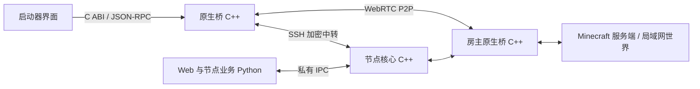

<div align="center">

# Minecraft Tunnel Native

**自托管的 Minecraft 联机节点 · C++20 数据转发 · 原版客户端接入**

[](https://github.com/vdjango/minecraft-tunnel-native/actions/workflows/core.yml)
[](CMakeLists.txt)
[](LICENSE)

[快速开始](#快速开始) · [性能实测](#性能实测) · [部署指南](docs/deployment.md) · [启动器接入](#启动器接入) · [协议文档](PROTOCOL_STANDARD.md)

</div>

Minecraft Tunnel Native 为 Minecraft Java 版提供房间联机、P2P 直连和加密中转。玩家通过支持本项目协议的启动器添加节点、创建或加入房间，原版游戏无需安装 Mod。

节点可独立部署，也可加入节点联邦。服务端以 **Ubuntu** 为主要部署平台；客户端原生桥面向 **Windows、macOS 和 Linux**，提供动态库和独立进程两种接入方式。

## 核心能力

- **原生数据转发**：C++20 负责 SSH、STUN、P2P 和游戏字节转发；工作线程、有界缓冲与背压控制并发流量。
- **直连与中转**：自动尝试 WebRTC P2P，协商失败时使用 SSH 加密中转；同一房间可同时服务直连和中转玩家。
- **带宽优化**：中转支持 Zstandard 自适应压缩，收益不足时切换原始流；Minecraft 自身已压缩或加密的数据不保证额外收益。
- **节点联邦**：共享已验证的节点与房间目录，直接定位房间所属节点；带签名、并发预算和退避机制，当前最多 32 个成员。
- **Web 管理**：首次部署向导、账号与好友、房间权限、节点网络、实时带宽及问题反馈。
- **可追踪的运行状态**：心跳、容量限制和逐玩家日志，记录连接路径、流量、背压及关闭原因。

## 架构



**游戏数据面由 C++ 处理。** 客户端界面通过桥发起操作，游戏连接直接进入本地桥；服务端 Python 负责 Web、账号、房间授权与联邦目录业务。节点仍需要 Python 运行这些业务，独立原生桥运行时无需 Python。

## 快速开始

需要 CMake 3.24+、C++20 编译器、OpenSSL 3.x，以及 Python 3.11+。以下命令面向 Ubuntu 24.04，从源码构建节点与桥：

```bash
sudo apt-get update
sudo apt-get install -y git build-essential cmake pkg-config libssl-dev python3-venv

git clone https://github.com/vdjango/minecraft-tunnel-native.git
cd minecraft-tunnel-native
python3 -m venv .venv
.venv/bin/pip install -r requirements.txt
.venv/bin/python scripts/fetch_deps.py

cmake -S . -B build -DCMAKE_BUILD_TYPE=Release
cmake --build build --parallel 2
cmake --install build --prefix "$PWD/runtime"

export BUGGCRAFT_NATIVE_CORE="$PWD/runtime/bin/buggcraft-core"
.venv/bin/python web/main.py \
  --directory "$HOME/.local/share/buggcraft-node" --no-browser
```

首次启动会打印带一次性令牌的 HTTPS 设置链接。将 `SERVER_IP` 替换为服务器地址，核对终端中的证书指纹，在网页中完成配置。后续使用相同的数据目录启动即可。向导使用自签名证书，正式对外服务建议配置域名与受信任证书。

| 默认端口 | 用途 |
| :--- | :--- |
| TCP `3333` | 启动器连接与 SSH 加密中转 |
| UDP `3333` | STUN，辅助 P2P 建立连接 |
| TCP `18443` | HTTPS 初始化与 Web 管理 |

防火墙和安全组需放行实际配置的端口，节点对外地址应填写玩家能够访问的域名或 IP。初始化链接、个人接入码、管理凭据和私钥应妥善保存。

继续阅读：[生产部署与 systemd](docs/deployment.md) · [Windows / macOS 构建与打包](docs/build.md) · [配置示例](config.example.ini)。

## 性能实测

以下为 **2026-10-23 的项目自测**，附测试方法、原始 JSON 和版本标识，未经过独立第三方认证。它们描述对应版本和负载下的表现，不能直接换算为公网带宽、可承载玩家数或后续版本的性能保证。

**节点转发对比**：Ubuntu 24.04、4 vCPU、约 3.7 GiB RAM；同机回环网络，32 条流、4 个房间，每流上传 32 MiB 并回显。两种实现使用相同 AES-128-GCM 算法，关闭 SSH 和游戏流压缩，校验长度、SHA-256 与 EOF。下表为三轮结果的中位数；服务器资源包含 Python 管理进程及原生子进程。

| 指标 | Python 转发 | C++ 转发 + Python 管理 |
| :--- | ---: | ---: |
| 应用载荷出口吞吐 | 86.44 MiB/s | **174.93 MiB/s** |
| 完成时间 | 23.6938 s | **11.7077 s** |
| 服务器累计 CPU 时间 | 11.81 s | **8.19 s** |
| 服务器峰值 RSS | 150.27 MiB | **122.49 MiB** |
| 空载回声 RTT 中位数 | 0.604 ms | **0.333 ms** |

这一负载下，吞吐中位数为原实现的 **2.02 倍**，累计 CPU 时间减少 **30.7%**。三轮吞吐范围分别为 65.33–105.57 与 172.28–175.87 MiB/s；单流测试中原生方案的总 RSS 则高于 Python，资源优势取决于负载。[测试方法](docs/validation-20261023.md#ubuntu-性能对比) · [三轮统计](docs/measurements/ubuntu-32-stream-median.json)

**30 分钟持续负载**：真实 C++ 节点与桥，3 名访客、9 条持续大流和 3 条 RTT 探测流，另完成 3306 轮短连接及控制请求。实际运行 1800.217 秒，已校验回显负载 **186.314 GiB**，平均 **105.992 MiB/s**；30 秒窗口吞吐为 101.85–108.58 MiB/s，最大探测 RTT 为 26.208 ms。此项为 Ubuntu 回环传输测试，未运行游戏 GUI。[完整范围与日志观察](docs/validation/bridge-soak-30min-20261023.md) · [结果 JSON](docs/measurements/bridge-soak-30min-20261023.json)

**原版游戏与压缩**：另有 4 个 Mojang 原版 1.21.8 GUI 客户端的进服、移动、挖掘、放置和重进记录；该次短测的应用层字节节省为 **6.13%**，不含 SSH/TCP 开销，也不代表固定压缩率。[原版实测](docs/validation-20261023.md#真实原版多人游戏) · [压缩协议与边界](docs/relay-compression.md)

测量口径、原始数据索引和复现命令见 [性能与验证](docs/performance.md)。

## 启动器接入

原生桥承接节点接入、房间生命周期、选路、P2P/中转、压缩、游戏状态、聊天与整合包传输。启动器负责展示页面、提交操作和消费事件，将加入房间后返回的 `127.0.0.1:端口` 交给游戏。

| 入口 | 适合的集成方式 | 文档 |
| :--- | :--- | :--- |
| C ABI 动态库 | Python、C/C++、C#、Rust 等通过 FFI 调用 | [C 头文件](include/buggcraft/bridge.h) · [调用与内存管理](docs/bridge-library.md) |
| 独立进程 | 启动 `buggcraft-bridge`，经 stdin/stdout 交换 JSON Lines | [JSON-RPC 协议](PROTOCOL_STANDARD.md) |

两种入口共用相同 C++ 实现。Windows 使用 `bin/buggcraft_bridge.dll`，Linux 使用 `lib/libbuggcraft_bridge.so`，macOS 使用 `lib/libbuggcraft_bridge.dylib`。打包时保留完整安装目录与相对路径，使用绝对路径加载，避免与 Qt 或其他软件的依赖库混用。[发行目录说明](docs/build.md#发行目录)

- **启动器接入码**：以 `buggnode1-` 开头，用于 `node.add`；个人接入码还提供账号与好友授权。
- **房间邀请码**：以 `bugg1-` 开头，用于 `room.join`。

## 可靠性与边界

心跳用于发现异常退出；联邦查询使用已同步目录和受限直查，游戏流量无需沿节点邀请链逐级转发。中间邀请节点失联后，已互相发现并可直接通信的其他节点可继续工作。[心跳与故障测试](docs/validation/heartbeat-federation-20261023.md) · [17 节点长链测试](docs/validation/federation-chain-20261023.md)

已建立的 TCP 游戏流不能无缝迁移到另一节点；承载该流的节点失联后，需要重新连接。P2P 能否建立取决于双方网络、NAT 与防火墙。动态库和可执行文件均受操作系统应用控制约束，当前项目未提供受信任代码签名或 Apple 公证。

逐玩家日志记录传输元数据，不保存游戏包内容；反馈前仍应检查诊断文件中的个人信息。[日志与保留策略](docs/validation/player-log-retention.md)

## 开发与测试

构建后先运行原生测试，再运行真实节点和桥的集成测试。以下命令使用已安装的 Ubuntu 运行目录：

```bash
export BUGGCRAFT_NATIVE_CORE="$PWD/runtime/bin/buggcraft-core"
export BUGGCRAFT_BRIDGE_EXECUTABLE="$PWD/runtime/bin/buggcraft-bridge"
export BUGGCRAFT_BRIDGE_LIBRARY="$PWD/runtime/lib/libbuggcraft_bridge.so"
export BUGGCRAFT_BRIDGE_PACKAGE="$PWD/runtime"

ctest --test-dir build --output-on-failure
.venv/bin/python -m unittest tests.test_native tests.test_bridge \
  tests.test_bridge_services tests.test_bridge_library tests.test_route_selection \
  tests.test_node_health tests.test_player_logs -v
.venv/bin/python -m unittest tests.test_federation_budget tests.test_federation_lookup \
  tests.test_federation_resilience tests.test_federation_chain -v
.venv/bin/python scripts/check_compatibility.py
```

CI 配置覆盖 Ubuntu、Windows MSVC、macOS ARM64 与 Intel；各平台是否通过应以对应提交的 [Actions 结果](https://github.com/vdjango/minecraft-tunnel-native/actions/workflows/core.yml) 为准。[原生接管验证记录](docs/validation/native-cutover-20261023.md) 单独列出了本机验证及尚未验证的范围。

| 目录 | 内容 |
| :--- | :--- |
| `core/` | 节点 SSH / STUN、转发、流控与 IPC |
| `bridge/` | 客户端原生桥与 C ABI 实现 |
| `include/`、`bindings/` | 公共 C 头文件与语言绑定 |
| `web/`、`site/` | Web、节点业务与静态页面 |
| `tests/`、`tests/cpp/` | 集成测试与原生单元测试 |
| `scripts/`、`cmake/` | 依赖准备、构建、测量及打包 |
| `docs/` | 协议、部署、验证方法与测量数据 |
| `compatibility/` | 面向当前核心执行的旧协议测试契约 |

## 许可证

本项目采用 [AGPL-3.0-or-later](LICENSE)。第三方依赖及其许可见 [THIRD_PARTY_NOTICES.md](THIRD_PARTY_NOTICES.md) 与 [licenses/](licenses/)，分发时应保留相应声明。
