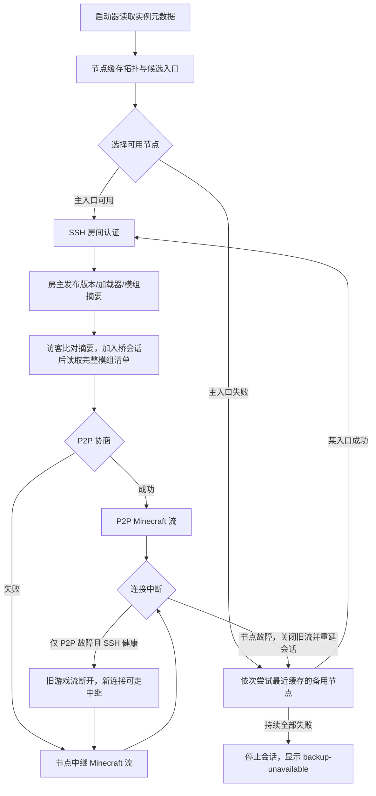
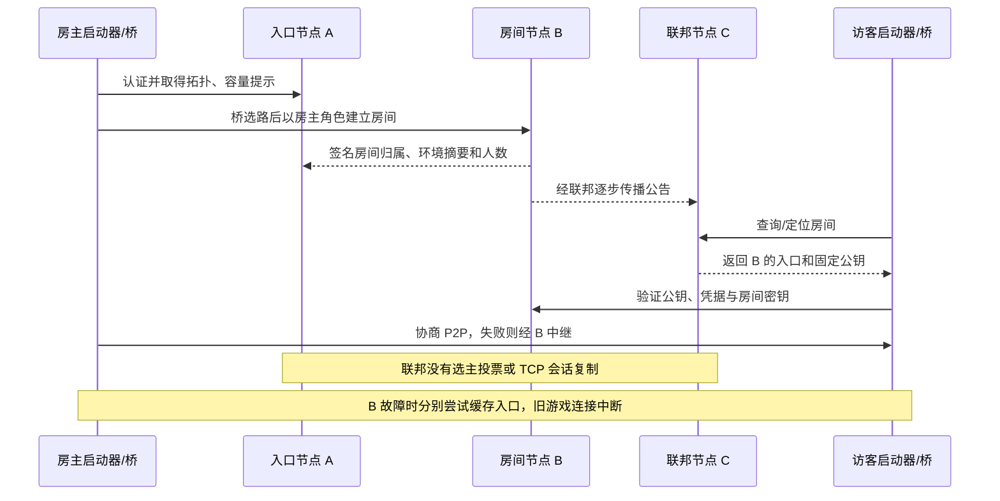

# 启动器联机与联邦故障流程

启动器提供实例的 Minecraft 版本、协议号、加载器与加载器版本；原生桥扫描实例 `mods` 目录、计算每个 JAR 的 SHA-256，将最多 24 项预览、完整数量与清单摘要合并进房间元数据。节点保存并签名公告，不替房主加载模组。完整字段与时序见[游戏环境与模组同步](protocol/game-metadata.md)。

备用节点来自已验证的拓扑或用户明确添加的候选。本地最多缓存 32 条，每次向桥传入最多 5 条；新拓扑为空或刷新失败时保留最近有效入口。会话用创建时的候选重连，采用有上限的指数退避；候选长期全部不可用时停止并报告 `backup-unavailable`，用户可重新探测。节点故障后已建立的 Minecraft TCP 流会中断，游戏需要重新加入；这里不承诺无缝迁移。P2P 失败只影响当前玩家的数据流，SSH 控制通道和其他玩家的中继流继续工作。

节点联邦传播签名的房间摘要、容量提示及包括私密房间的聚合人数，过期记录不计入全网在线数。在线列表通过仅联邦节点可调用的认证 RPC 分页获取，普通用户不能读取诊断日志；私密房间标题会脱敏。房主掉线后在备用节点重建房间，访客仍需找到房间所在节点；联邦是签名目录和故障发现机制，没有分布式一致性选主或 TCP 状态复制。`game` 字段包含 `version`、`protocol`、`loader`、`loader_version`、`mods_count`、`mods_hash` 和最多 24 项 `mods` 预览，加入前由启动器核验；完整模组清单通过独立分页 RPC 和受限文件通道获得。

## 谁决定房间放在哪个节点

房主桥的选路负责新房间放置，联邦负责传播归属和容量提示；不是所有节点投票选出房主。访客先定位现有房间再直连其归属节点。房主与访客切换到不同候选时不保证立即恢复，不能把独立重试描述成一致性迁移。

## 所有备用都不可用时

首次建房/加入失败直接返回错误，不启动永久重试。已建立会话失联后的连续重建失败最多延迟重试 6 次，间隔 1/2/4/8/10/10 秒，连接耗时另计；最终停止并报告 `backup-unavailable`。成功重建会重置计数，用户明确关闭不会触发恢复。会话使用创建时的候选，不会自动订阅后续拓扑；旧缓存不绕过令牌到期或公钥校验。

此时启动器应保留实例配置、给出明确的停止原因与重新探测入口，从可信渠道更新接入码，再重新创建桥会话。它不能凭空找出未缓存的新节点。详见[恢复与兼容](protocol/compatibility.md)。

安全边界：凭据和房间角色用于认证，不能凭公开协议识别“官方二进制”。固定密钥可被提取，握手检查不能替代游戏补丁、授权与资源限额。详见[安全说明](security.md)。
