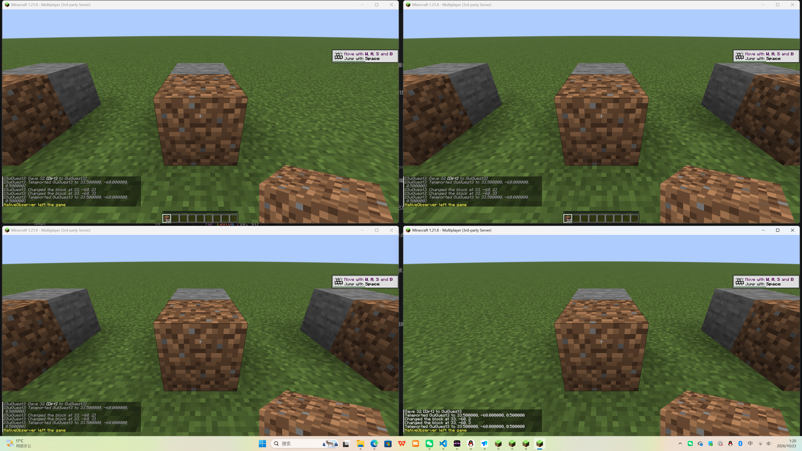

# 原生节点验证记录：2026-10-23

## 真实原版多人游戏

已实际启动 Mojang 原版 Minecraft Java 1.21.8 服务端和 **4 个完整原版 GUI 客户端**，
游戏进程没有安装 Mod。测试使用独立平坦世界、独立客户端目录及离线测试身份。
服务端只监听本机，节点 SSH 认证和房间授权照常启用。

路径为 Windows 原版客户端 → Buggcraft 网络组件 → Ubuntu 原生 C++ 节点 →
房主网络组件 → Windows 原版服务端。Ubuntu 测试节点只绑定独立的临时本机端口，
通过已有管理 SSH 连接转发测试入口，没有替换生产节点。

此次强制 `transport_policy=relay`，目的是检验新核心中转游戏的完整路径。
它不证明跨运营商公网 P2P 打洞成功；P2P 的网卡/STUN 修复需另做跨网络玩家复测。

| 实际操作 | 结果 |
| --- | --- |
| GuiHost、GuiGuest1、GuiGuest2、GuiGuest3 同时进服 | 通过 |
| 每个原版窗口执行向前移动 | 观察端分别收到 13、12、13、12 次连续移动更新 |
| 每个窗口挖掉石头，再放置泥土 | 每人都观察到 `stone → air → dirt` |
| 每个原版客户端接收其他玩家操作消息 | 通过，检查了全部 4 份客户端日志 |
| 关闭并重新启动 GuiGuest3 的完整 Java 客户端 | 成功重新进服 |
| 交互后维持 30 秒多人连接 | 客户端均存活 |
| 结束后停止本次创建的 Java、网络组件及临时节点 | 已清理 |

观察端另有一个协议客户端，用于记录服务器广播的实体与方块变化；上表中的
4 名玩家都是完整 Mojang GUI 客户端。窗口操作通过 Win32 消息送到各自游戏窗口，
避免 Windows 自动化桌面的前台焦点限制影响 IDE。



可随源码保存的结果：[原版实测 JSON](measurements/vanilla-1.21.8.json)。
完整本机日志位于 `validation-artifacts/vanilla-20261023-011827/`：
`server.log`、各客户端 `logs/latest.log`、`operations.json`、`transport.log`。
首次实测的进服、方块同步也通过，后续复测增加了实际移动和完整客户端重启。

## 真实游戏压缩效果

保持 Minecraft 默认 `network-compression-threshold=256`，测试结果为：

| 两端全部游戏流的发送方向汇总 | 字节数 |
| --- | ---: |
| 压缩前应用字节 | 515,041 |
| 编码后字节，包含 BCZ1 magic 与帧头 | 483,468 |
| 本次应用层流量节省 | **6.13%** |

这不是 SSH/TCP 总流量或计费带宽；统计中包括观察端及状态探测游戏连接。
压缩收益因世界、活动和 Minecraft 自身压缩而变化，不能承诺固定节省比例。
这次短测只覆盖平坦世界、进服、移动、挖掘/放置和重进，不代表持续高速跑图负载。

实测发现小包逐帧封装会放大流量，已加入每方向的原始后续流切换。无整体收益时，
后续数据不再增加逐帧开销。关闭节点压缩和旧客户端原始中转路径也做了独立验证。

## Ubuntu 性能对比

环境：Ubuntu 24.04 LTS x86_64、4 vCPU、约 3.7 GiB RAM；GCC/CMake Release，
libssh 0.12.2、系统 OpenSSL 3.0.13、Python 3.12.3、AsyncSSH 2.24.1、
cryptography 50.0.2。psutil 7.2.2 仅用于测量进程。依赖版本与核心源码摘要
已写入结果 JSON。

新旧节点各自是独立子进程；服务器 CPU/RSS 将 Python 管理进程和原生子进程
一起计算。发生器在另一进程，通过真实 SSH 连接发送不可压缩数据，逐流核对
长度、SHA-256 及 EOF。两边固定为 AES-128-GCM、无 SSH 层压缩，使用相同房间密钥
和流数量。每方向的游戏传输未启用 Zstandard，避免把压缩收益计入转发性能。

32 条流、4 个房间、每流上行 32 MiB 并全部回声，共 2 GiB 节点出口载荷。
原生节点使用 4 个工作线程，每方向环形缓冲 64 KiB。下表为三次运行的中位数：

| 指标 | 原 Python 转发 | 原生转发 + Python 管理 |
| --- | ---: | ---: |
| 完成时间 | 23.6938 s | 11.7077 s |
| 服务器累计 CPU 时间 | 11.81 s | 8.19 s |
| 应用载荷出口吞吐 | 86.44 MiB/s | 174.93 MiB/s |
| 服务器总峰值 RSS | 150.27 MiB | 122.49 MiB |
| 空载回声 RTT 中位数 | 0.604 ms | 0.333 ms |
| 每轮 RTT p95 的中位数 | 0.817 ms | 0.407 ms |

CPU 时间中位数减少约 30.7%，吞吐中位数约为 2.02 倍。Python 版这三轮的
吞吐范围为 65.33–105.57 MiB/s，原生版为 172.28–175.87 MiB/s，应结合范围判断，
不能只看单轮最好结果。这个发生器同样消耗 CPU，测试也在回环网络上运行，
不能当作物理出口带宽、远程游戏延迟或核心极限吞吐的保证。

少量连接时，原生版额外进程仍有内存成本。例如单流同算法测试总 RSS 为
51.27 MiB，对照 Python 45.01 MiB；不能把 32 流的内存优势外推到所有情况。

原始结果：[1/8/32 流](measurements/ubuntu-aes-gcm.json)、
[32 流复测 1](measurements/ubuntu-repeat1.json)、
[32 流复测 2](measurements/ubuntu-repeat2.json)、
[三轮统计](measurements/ubuntu-32-stream-median.json)。

## 功能、平台与故障检查

| 检查 | 结果 |
| --- | --- |
| Ubuntu Release 构建、安装后运行 | 通过 |
| Windows MinGW Release 构建、安装后运行 | 通过；测试 PATH 仅含打包 DLL 与 Windows 系统目录 |
| 原 Python 协议契约移到真实 C++ 节点 | 40 项通过 |
| 原生专项：目录/权限、2 MiB 完整转发/半关闭、核心被终止、IPv6 SSH/STUN、控制通道 EOF、中文密钥路径 | Ubuntu / Windows 验证 |
| 压缩：数据完整性、畸形/截断/解压上限、小包原始切换、关闭策略、协商失败回退、P2P 失效后的新流回退 | 7 项通过 |
| 启动器 ICE/P2P、房间权限、生命周期、关闭及诊断回归 | 56 项运行，55 通过、1 项跳过 |
| Ubuntu AddressSanitizer / UBSan / LeakSanitizer | 运行真实传输专项，未报告内存或未定义行为错误 |
| macOS / Windows MSVC | CI 已配置，本次没有实际执行，不能标为已验证 |

兼容测试覆盖公开/邀请码/私有房间授权、跨房间隔离、流数量限制、原始游戏与
整合包转发、目录与房间控制、P2P 信令与 STUN、心跳、账号复制、联邦签名与
身份验证、玩家诊断。测试复用原 Python 业务处理器；不是所有业务都重写成 C++。
流量计数允许最多约一秒的汇总延迟，测试仍核对最终完整字节数。

Windows Python 3.11 的部分关闭测试会打印 Proactor socket reset 回调告警；
测试断言通过，真实四客户端运行的网络组件日志没有该告警。Ubuntu Python 3.12
未出现此现象。此项作为运行时差异保留记录，没有通过吞掉所有异步异常掩盖它。

## 复现

```bash
python -m unittest tests.test_native -v
python scripts/check_compatibility.py
python scripts/benchmark.py --mib 32 --flows 1 8 32 --workers 4 --buffer-kib 64 --output benchmark.json
```

在本工作区的 Windows 环境，安装 `minecraft_launcher_lib`、Pillow、网络组件依赖，
确保 Java 21、既有 Mojang 1.21.8 客户端资源和服务端 JAR 可用后执行：

```powershell
python scripts/vanilla_multiplayer.py
```

脚本复用工作区已有 SSH 测试连接器，认证信息不写入命令行或结果文件。所有游戏
世界、客户端存档和日志写入独立运行目录；只结束这次创建的进程。
